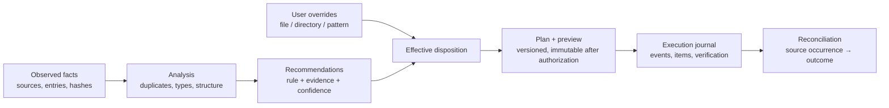
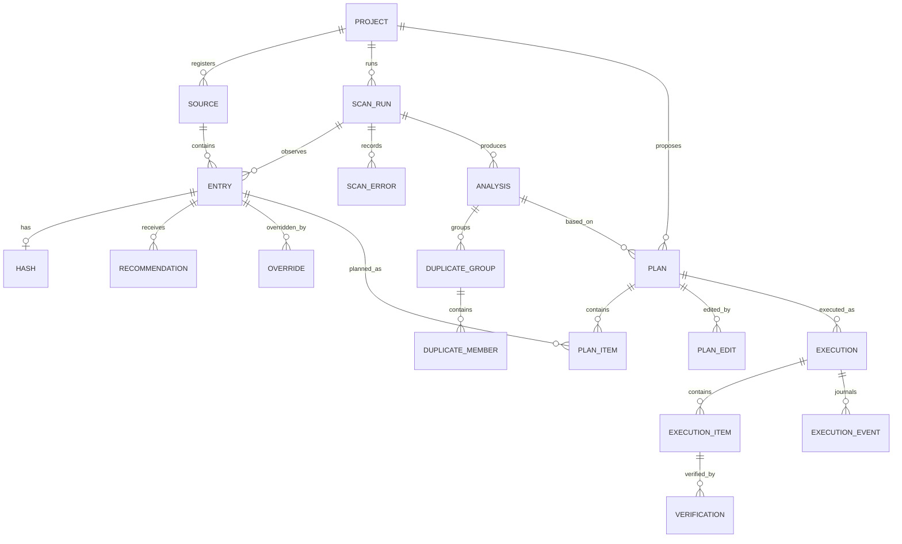

# CP1-B — Proposed Data Model

**Status:** Proposal. The CP1 implementation contains only the tables marked
**Implemented**; everything else is the target schema for CP2+.
**Principle:** observed facts, recommendations, user decisions, plans, and
execution records are separate. A policy change must never rewrite history.

---

## 1. Separation model



| Layer | Mutability | Source of truth |
| --- | --- | --- |
| Observed | Append-only per scan run | Filesystem + hashes |
| Recommendation | Recomputed per analysis | Rule/profile version |
| Override | Explicitly created/reverted | User |
| Effective | Derived | Resolver |
| Plan | Immutable version; edits create drafts | Plan hash |
| Execution | Append-only events | Journal |

---

## 2. Entity-relationship overview



`OVERRIDE` is attached to a project and may target a file, a directory, or a
pattern; the diagram shows the common file case.

---

## 3. Implemented CP1 schema

These tables exist today in `src/reclaim/store.py` (schema version 3; M1 adds
analysis, override, plan, authorization, execution, and journal tables). They are
the foundation, not the final model. See
[`docs/m1/data-model.md`](../m1/data-model.md) for the M1 schema details.

### 3.1 `meta`

| Column | Type | Notes |
| --- | --- | --- |
| key | TEXT PK | e.g. `schema_version` |
| value | TEXT | |

### 3.2 `sources`

| Column | Type | Notes |
| --- | --- | --- |
| source_id | TEXT PK | Stable slug, e.g. `source-a` |
| label | TEXT | User-facing name; may be private |
| root_path | TEXT | As registered |
| canonical_root | TEXT | Resolved absolute path |
| root_identity | TEXT | Canonical root + volume identity; cache identity |
| priority | INTEGER | Lower = preferred for canonical copy |
| registered_at | TEXT | UTC ISO-8601 |

**Future additions:** `project_id`, `filesystem`, `case_sensitive`,
`read_only_probe`, `coverage_status`, `coverage_note`, `last_seen_at`.

### 3.3 `scan_runs`

| Column | Type | Notes |
| --- | --- | --- |
| run_id | TEXT PK | Timestamp + random suffix |
| started_at / finished_at | TEXT | UTC |
| tool_version | TEXT | Reproducibility |
| config_sha256 | TEXT | Canonical config fingerprint |
| status | TEXT | running / scanned / complete / failed / partial |
| source_fingerprints_json | TEXT | Per-source metadata-consistency digest (paths, sizes, mtimes, entry types); **not** byte-level integrity |
| source_identities_json | TEXT | Root identities used by the run |
| notes | TEXT | Free-form run notes |

**Future additions:** `project_id`, `host_platform`, `scan_options_json`,
`entry_count`, `error_count`, `completed_sources_json`.

### 3.4 `entries`

One row per observed path occurrence per scan run.

| Column | Type | Notes |
| --- | --- | --- |
| entry_id | INTEGER PK | |
| run_id | TEXT FK | |
| source_id | TEXT FK | |
| rel_path | TEXT | POSIX separators, `"."` for root, no leading slash |
| parent_rel_path | TEXT | `NULL` for root |
| name | TEXT | Final component |
| depth | INTEGER | Root = 0 |
| entry_type | TEXT | file / dir / reparse / excluded / unknown |
| size_bytes | INTEGER | `NULL` when metadata unavailable |
| created_ns | INTEGER | Null on POSIX where creation time is unavailable |
| modified_ns | INTEGER | |
| accessed_ns | INTEGER | Evidence only; not used for decisions |
| mode | INTEGER | Permission bits as observed |
| attributes | INTEGER | Native attributes (Windows) |
| is_hidden / is_system / is_reparse / is_cloud / is_media_library | INTEGER | 0/1 |
| link_target | TEXT | Recorded, never followed |
| error_code / error_message | TEXT | Enumeration failure, if any |
| note | TEXT | e.g. excluded by configuration |

Constraints: `UNIQUE(run_id, source_id, rel_path)`; indices on
`(run_id, source_id)`, `(run_id, source_id, parent_rel_path)`,
`(run_id, entry_type)`, `(run_id, size_bytes)`, `(run_id, is_media_library)`.

**Future additions:** `kind` (derived), `extension`, `is_sparse`, `is_offline`,
`hardlink_group`, `alternate_streams_json`.

### 3.5 `hashes`

Exactly one row per file entry per run.

| Column | Type | Notes |
| --- | --- | --- |
| entry_id | INTEGER PK/FK | |
| algorithm | TEXT | `sha256` |
| digest | TEXT | 64 hex chars when `status='ok'` |
| status | TEXT | pending / ok / error / deferred |
| error_code / error_message | TEXT | |
| bytes_read | INTEGER | |
| signature_hex | TEXT | First 64 bytes, analysis aid only |
| hashed_at | TEXT | UTC |
| duration_ms | INTEGER | |

Constraints: `status IN ('pending','ok','error','deferred')`; `digest` non-null
when `ok`; no digest when `error` or `deferred`.

### 3.6 `hash_cache`

| Column | Type | Notes |
| --- | --- | --- |
| source_id, rel_path, size_bytes, modified_ns, algorithm | PK | Cache identity |
| root_identity | TEXT | Must match the source's current root identity |
| digest, signature_hex, hashed_at | | |

A cache hit requires source, relative path, size, mtime, algorithm, **and root
identity** to match. A source registration whose canonical root or volume
changes invalidates its cache. Cache rows are evidence, not authority: a later
verification can invalidate them.

### 3.7 `scan_errors`

`error_id`, `run_id`, `source_id`, `rel_path`, `phase` (`scan`), `code`,
`message`, `occurred_at`. Hash errors remain in `hashes` and are unioned into the
error report.

### 3.8 `verification_checks`

`check_id`, `run_id`, `check_name`, `status` (PASS/FAIL/ERROR), `detail`,
`checked_at`. Used for source metadata-consistency checks and sample
re-hashing. A metadata check is not a byte-level integrity proof.

---

## 4. Target schema additions

### 4.1 Source registration

**`source_probes`** — one row per source per registration/validation:

| Column | Notes |
| --- | --- |
| probe_id, source_id, probed_at | |
| volume_id | Serial/GUID; detects a different volume at the same mount point |
| filesystem | NTFS, APFS, ext4, exFAT, … |
| case_sensitive | Boolean probe result |
| unicode_normalization | NFC/NFD/unknown |
| read_only | Boolean read probe |
| max_path_length | Observed/declared limit |
| free_bytes | Capacity at registration |
| detail_json | Raw results |

**`sources.coverage_status`** ∈ `complete`, `partial`, `unknown`, `unavailable`.
This is how Reclaim records that an earlier collector skipped junctions or that
a cloud folder was not hydrated. It must appear in every executive report.

### 4.2 Analysis and recommendations

**`analyses`**

| Column | Notes |
| --- | --- |
| analysis_id PK | |
| run_id FK | Inventory snapshot analyzed |
| created_at | |
| types_profile_version, policy_version | Reproducibility |
| status | running / complete / failed |
| metrics_json | Aggregate counts, overlap, type distribution |
| tool_version | |

**`duplicate_groups`**

| Column | Notes |
| --- | --- |
| group_id PK | Stable, derived from digest + analysis |
| analysis_id FK | |
| digest | SHA-256 |
| size_bytes | |
| occurrence_count, source_count | Denormalized for review |
| redundant_bytes | `size × (occurrences − 1)` |
| canonical_entry_id FK | Chosen by policy, reviewable |
| canonical_reason | Why this occurrence was preferred |

**`duplicate_members`** — `(group_id, entry_id, role)` where role is
`canonical` or `duplicate`. Primary key `(group_id, entry_id)`.

**`recommendations`**

| Column | Notes |
| --- | --- |
| analysis_id, entry_id | PK |
| disposition | Closed enum |
| rule_id | Stable rule identifier |
| rationale | Human-readable |
| confidence | 0.0–1.0 |
| evidence_json | Scores, matched segments, hash group, deferral reason |
| created_at | |

Recommendations are replaced atomically per analysis; they are not edited in
place.

### 4.3 Overrides

**`overrides`**

| Column | Notes |
| --- | --- |
| override_id PK | |
| project_id | |
| scope | `file` / `directory` / `pattern` / `project` |
| target | Relative path, directory prefix, or glob; empty for project |
| disposition | Action to apply |
| destination_rel | Optional destination override |
| reason | Required free text |
| created_at, created_by | Audit |
| active | Boolean; revert = deactivate, not delete |
| supersedes_id | Prior override, if any |
| note | |

Resolution order is deterministic:

```text
active file override
  > active directory override (longest matching prefix)
    > active pattern override (highest specificity, then newest)
      > profile rule (priority)
        > safe default retain
```

The resolver returns `effective_disposition`, `decision_source`, `reason`, and
the contributing override/rule ids. This result is persisted in the plan, not
recomputed at execution time.

### 4.4 Plans

**`plans`**

| Column | Notes |
| --- | --- |
| plan_id PK | |
| project_id, analysis_id | |
| version | Monotonic per project |
| parent_version | Draft lineage |
| status | draft / validated / authorized / executing / complete / superseded / rejected |
| created_at, updated_at, authorized_at | |
| plan_hash | SHA-256 of canonical plan content |
| summary_json | Counts by disposition, bytes, destination roots |
| destination_root | Validated absolute root |
| validation_json | Latest validation result |
| created_by | CLI/GUI/user |

**`plan_items`**

| Column | Notes |
| --- | --- |
| plan_id, entry_id | PK |
| effective_disposition | Resolved action |
| destination_rel | POSIX-style relative destination, or null |
| canonical_entry_id | For duplicates: retained occurrence |
| decision_source | file_override / directory_override / recommendation / default |
| reason | Required |
| validation_status | ok / rewritten / rejected |
| validation_detail | Collision/rename explanation |

Constraints: unique `(plan_id, normalized_destination_rel)` for retained items;
every retained item must have a destination; every excluded item must have a
reason.

**`plan_edits`** — append-only edit log:

`edit_id`, `plan_id`, `sequence`, `operation` (`set_destination`, `rename_folder`,
`create_folder`, `move_group`, `exclude`, `include`, `revert`), `target`,
`before_json`, `after_json`, `created_at`, `created_by`.

This is the basis for undo/revert and for explaining a plan diff.

### 4.5 Execution

**`executions`**

| Column | Notes |
| --- | --- |
| execution_id PK | |
| plan_id, plan_version, plan_hash | Exact authorized plan |
| destination_root | Canonical, validated |
| status | authorized / running / paused / complete / failed / rolled_back |
| started_at, finished_at | |
| authorized_at, authorized_by | Explicit authorization |
| tool_version, host_platform | |
| summary_json | Counts, bytes, failures |

**`execution_items`**

| Column | Notes |
| --- | --- |
| execution_item_id PK | |
| execution_id, plan_item_id | |
| state | pending / copying / copied_temp / verified / committed / skipped / failed |
| source_path, destination_path | Absolute, private |
| expected_digest, actual_digest | |
| bytes_copied | |
| attempts | |
| error_code, error_message | |
| started_at, finished_at | |

**`execution_events`** — append-only journal:

`event_id`, `execution_id`, `execution_item_id`, `sequence`, `event_type`,
`occurred_at`, `detail_json`.

Event types: `EXECUTION_STARTED`, `ITEM_STARTED`, `TEMP_CREATED`,
`COPY_COMPLETED`, `DEST_HASH_VERIFIED`, `RENAMED`, `ITEM_COMMITTED`,
`ITEM_SKIPPED`, `ITEM_FAILED`, `EXECUTION_PAUSED`, `EXECUTION_RESUMED`,
`EXECUTION_COMPLETED`, `EXECUTION_FAILED`.

**`destination_verifications`** — `verification_id`, `execution_id`,
`execution_item_id`, `expected_digest`, `actual_digest`, `size_bytes`, `status`,
`verified_at`.

### 4.6 Audit

**`audit_events`** — cross-cutting, append-only:

`audit_id`, `occurred_at`, `actor` (local user/CLI/GUI), `action`, `subject_type`,
`subject_id`, `detail_json`.

Record source registration, config changes, override changes, plan
authorization, execution start/stop, and exports. This is separate from the
execution journal so project-level actions are auditable.

---

## 5. Invariants

1. **One occurrence per path per run.** `(run_id, source_id, rel_path)` unique.
2. **Every file has a hash state.** `hashes` row exists for every `entry_type='file'`;
   `status` is `ok`, `error`, `deferred`, or `pending` (only during work).
3. **Exact duplicate claims use complete digests.** No group without a digest.
4. **Every occurrence is preserved.** A duplicate group never deletes a member
   row; the canonical role is metadata.
5. **Plan items reference observed entries.** Foreign key to `entries`; no
   synthetic "file" without provenance.
6. **Effective disposition is explainable.** Every plan item has a
   `decision_source` and `reason`.
7. **Destinations are unique and validated.** No two retained items may resolve
   to the same normalized destination; validation runs before authorization.
8. **Authorization pins the plan.** Execution requires `plan_hash` and
   `plan_version`; any plan edit invalidates prior authorization.
9. **Execution never overwrites.** A destination collision is an error or a
   recorded disambiguation, never a silent replace.
10. **Execution never touches a source.** Source paths are read-only in the
    executor; destination paths must not be inside any source.
11. **Journal is append-only.** Corrections are new events, not edits.
12. **Reconciliation balances.** Every inventoried file occurrence has exactly
    one final outcome; counts must reconcile.
13. **Private data stays local.** No table or export is published by the product.

---

## 6. Plan document format

The database is the working store; a **plan document** is the portable,
reviewable artifact. Recommended split:

- `plan.json` — manifest, counts, rules/profile versions, source fingerprints,
  destination root, plan hash, and item page references;
- `plan-items.ndjson` — one JSON object per item for large plans (streamable,
  diffable, no 100 MB single JSON array);
- `plan-summary.md` — human-readable counts and destination preview.

Manifest example:

```json
{
  "schema_version": 1,
  "plan_id": "plan-20261121-0001",
  "version": 3,
  "parent_version": 2,
  "created_at": "2026-11-21T20:00:00Z",
  "project": "example",
  "analysis_id": "analysis-0007",
  "inventory_run_id": "run-20261121T195457Z-163547ea",
  "source_fingerprints": {"source-a": "sha256:…", "source-b": "sha256:…"},
  "policy_version": "default/1",
  "types_version": "default/1",
  "destination_root": "D:/Consolidated",
  "counts": {
    "total_occurrences": 86954,
    "retained": 41200,
    "excluded": 30700,
    "duplicate_omitted": 14900,
    "deferred_media": 72238,
    "needs_review": 154
  },
  "plan_hash": "sha256:…"
}
```

Item example:

```json
{
  "entry_id": 12345,
  "source_id": "source-a",
  "source_rel_path": "Documents/Example.pdf",
  "sha256": "…",
  "disposition": "retain",
  "destination_rel": "Documents/Example.pdf",
  "canonical_entry_id": null,
  "decision_source": "recommendation",
  "reason": "default-retain"
}
```

The plan hash is computed over a canonical serialization (sorted keys, sorted
item order by `entry_id`, normalized paths, no volatile timestamps inside the
hashed body).

---

## 7. Journal semantics

The journal is the execution audit trail and the resumption mechanism.

- Events are appended in sequence per execution; sequence gaps are detectable.
- An item's state is derivable from its events, but `execution_items.state` is
  maintained as a materialized convenience and can be rebuilt.
- A crash between `TEMP_CREATED` and `COPY_COMPLETED` leaves a temp file; resume
  deletes/ignores it and re-copies.
- A crash between `DEST_HASH_VERIFIED` and `RENAMED` can promote the verified
  temp file, but only after re-checking that the destination still does not
  exist.
- `ITEM_FAILED` records a stable error code; retry creates new events, not a
  rewritten history.

---

## 8. Versioning and migrations

| Version | Scope | Rule |
| --- | --- | --- |
| `schema_version` | SQLite tables | Forward-only migrations; backup before upgrade |
| `plan_schema_version` | Plan manifest/items | New fields optional; readers reject unknown major |
| `policy_version` | Rule file | Stored with analysis and plan |
| `types_version` | Type profile | Stored with analysis and plan |
| `tool_version` | Application | Stored with every run, plan, execution |
| `config_sha256` | Project config | Detects config drift between runs |

Rules:

- A schema upgrade is an explicit command, never implicit on open.
- Downgrades are unsupported; export before upgrading.
- A plan created under an older schema remains readable for audit, but new
  executions require a current-schema plan.
- Config drift is reported; it does not silently invalidate an inventory.

---

## 9. Storage, retention, and privacy

- The SQLite database contains private paths and hashes. Treat it as sensitive.
- Reports and plan exports are equally sensitive even when they contain no file
  contents.
- Recommended retention: keep completed scan runs and executions; prune only
  superseded analyses and draft plans, and only with explicit user action.
- A future "portable project" export should omit absolute source paths by
  default and retain relative provenance.
- Optional encryption (SQLCipher) is a later decision; it adds a dependency and
  key-management complexity. Default: OS file permissions + user responsibility.

---

## 10. Mapping to the CP1 implementation

| Target table | CP1 status |
| --- | --- |
| `meta`, `sources`, `scan_runs`, `entries`, `hashes`, `hash_cache`, `scan_errors`, `verification_checks` | Implemented (schema v3) |
| `source_probes` | Not implemented; source probe data is validated in memory only |
| `analysis_snapshots`, `recommendations` | Implemented in M1 (recommendation persistence) |
| `duplicate_groups`, `duplicate_members` | Computed at export/planning; not persisted as tables |
| `overrides` | Implemented in M1 |
| `plans`, `plan_items` | Implemented in M1; immutable plans, no edit log |
| `plan_edits` | Not implemented (M1 has no in-place plan editing) |
| `executions`, `execution_items`, `execution_events` | Implemented in M1 |
| `destination_verifications`, `audit_events` | Destination hashes/verification are recorded in execution items and `verification_checks`; no dedicated audit table |

This is intentional. CP1 proves the observation layer before committing to
decision and execution schemas that the operator has not yet reviewed.
