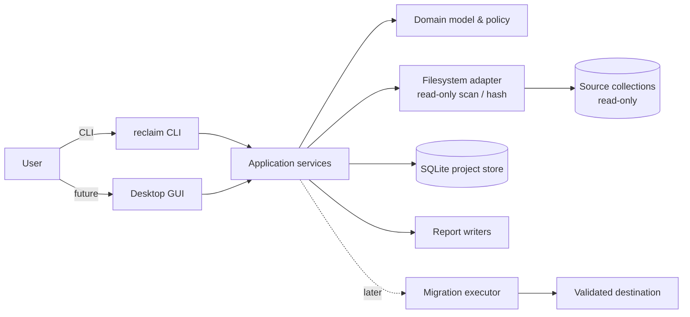
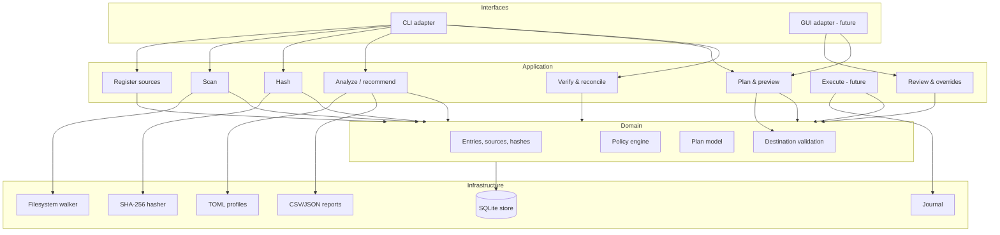

# CP1-B — Proposed Reclaim Engine Architecture

**Status:** Proposal for operator review. No migration executor or GUI is
implemented in CP1.
**Scope:** The reusable engine, its boundaries, and the decisions needed to
carry the initial migration through planning and execution without making that
migration a permanent architectural dependency.

---

## 1. Recommendation in brief

Build Reclaim as a **modular monolith in Python 3.11+**, with:

- a deterministic, read-only inventory core;
- **SQLite** as the durable project store (inventory, provenance, decisions,
  plans, journal);
- **TOML** for human-authored configuration and **JSON** for versioned plan
  interchange;
- a **CLI as the first interface**, calling application services that a later
  desktop GUI can call unchanged;
- **PySide6 (Qt)** as the recommended GUI toolkit when that checkpoint is
  authorized, with the GUI kept entirely outside the core;
- **PyInstaller/Nuitka** packaging into per-OS standalone executables;
- **no service, daemon, container, network stack, or database server**;
- **no content extraction, AI, or similarity analysis in the trusted core**;
  those are opt-in analyzers added later.

This is intentionally less machinery than the long-term product vision might
suggest. The initial dataset is large enough to expose real performance and
correctness problems (≈87,000 files, ≈88 GB, tens of thousands of photo-library
internals, long Unicode paths) but small enough that a single-process Python
engine with SQLite is comfortably sufficient.

---

## 2. What the CP1 audit requires from the architecture

The audit produced requirements that a generic design must respect. These are
stated as architectural drivers, not customer facts:

| Driver | Consequence |
| --- | --- |
| Sources are second-generation copies, not original machines; provenance is incomplete. | Model source coverage and confidence explicitly. Never present inventory as proof that a machine contained nothing else. |
| Prior collection skipped junctions, including cloud-redirected folders. | Links and cloud placeholders must be first-class recorded states, not silent omissions. |
| One collection contains a packaged photo library with tens of thousands of internal files. | Packaged libraries need a boundary: inventory metadata, defer content/hash-intensive work by policy, and keep the library intact. |
| Duplicate candidates span machines, folder names, and revisions. | Exactness must be hash-based; canonical-copy selection is a policy decision, never inferred from timestamps or names. |
| Long paths, Unicode names, case differences, and platform-specific attributes occur. | Path handling is a core service, not scattered string handling. |
| The same inventory must support CLI review now and a GUI later. | Application services and stable data contracts are mandatory; UI must not own business logic. |
| Source data is sensitive and may include medical, financial, military, and personal records. | Offline by default; no content inspection without an explicit, separately governed analyzer. |
| A scan can be interrupted by a laptop sleeping, a drive disconnecting, or a user closing the app. | Every long stage must be checkpointed and resumable. |

---

## 3. Principles translated into design rules

| Principle | Concrete rule |
| --- | --- |
| Preservation first | The core package contains no `unlink`, `rmtree`, `move`, or source-writing code. Execution writes only beneath a validated destination root. |
| Every file accountable | A source file exists in the inventory as exactly one occurrence record, with a hash or an explicit hash/deferral reason. A plan item references an occurrence, not just a path. |
| Decisions reversible | Observed facts are append-only per scan. Recommendations, overrides, and plans are separate rows/documents. A plan edit never mutates inventory. |
| Deterministic core | Traversal order, grouping, canonical selection, plan ordering, and report ordering have documented sort keys. No randomness in decisions. |
| Configurable behavior | Types, rules, exclusions, categories, and destination templates are data files. Customer names and paths never appear in `src/`. |
| Practical engineering | Add a dependency, service, or abstraction only when a checkpoint needs it. The CP1 implementation is a few thousand lines of standard-library Python. |

---

## 4. Technology decisions

### 4.1 Language: Python 3.11+

**Chosen.** Standard-library `os.scandir`, `hashlib`, `sqlite3`, `tomllib`,
`csv`, and `concurrent.futures` cover the entire CP1 workload. The language is
also the most practical route to one codebase across Windows, macOS, and Linux,
and it integrates cleanly with a future Qt GUI.

**Alternatives considered:**

- **Go** — better single-binary distribution and predictable concurrency, but
  slower iteration for analysis/reporting and a second language for the GUI.
- **Rust** — strongest safety and performance, but substantially higher
  development cost for a pre-alpha product whose bottleneck is disk I/O.
- **Node/Electron** — good UI ecosystem, but a weaker filesystem/forensic
  toolkit and a heavy runtime for a local utility.

**Revisit trigger:** hashing or planning throughput becomes the limiting factor
on very large datasets (millions of files), or packaging Python proves
unacceptable on a target OS. A Rust hashing/dedup helper can be introduced
behind the existing `ContentHasher` interface without changing the domain.

### 4.2 Persistence: SQLite

**Chosen.** A single-file, transactional, zero-administration database is the
right fit for a desktop tool that must work offline and survive interruption.
It keeps observed facts, user decisions, plans, and execution journal in one
portable project.

**Alternatives considered:**

- **DuckDB** — excellent analytical scans, but less suitable as the primary
  transactional store for mutable decisions and resumable writes; it can be an
  optional reporting engine later.
- **PostgreSQL** — requires a service and administration; rejected.
- **JSON/CSV files** — no transactions, no concurrent readers, no durable
  resumption; rejected as the system of record.
- **Embedded key-value stores** — lose relational integrity and ad-hoc audit
  queries; rejected.

**Revisit trigger:** reporting queries exceed a few seconds on multi-million-row
inventories. Add a derived DuckDB/Parquet analytics cache rather than replacing
the transactional store.

### 4.3 Configuration: TOML + JSON

- **TOML** for project files, profiles, and rule files: readable, typed, and in
  the standard library since 3.11.
- **JSON** for versioned migration plans and journal exports: unambiguous,
  diffable, and easy for a future GUI or external validator to consume.
- **SQLite** for state that changes per run.

YAML was rejected for the core because of implicit typing and parser
dependency/security history. Environment variables are limited to
non-sensitive overrides.

### 4.4 Interface: CLI first, GUI later

The CLI is a thin adapter over application services. Every operation returns a
structured result object and emits progress events. The future GUI calls the
same services in-process; it does not shell out to the CLI and does not query
SQLite directly.

### 4.5 GUI toolkit: PySide6 (recommended, not implemented)

| Option | Assessment |
| --- | --- |
| **PySide6 / Qt** | Mature tree/table views, model/view architecture for 100k-row exclusion review, native packaging, single language. Recommended. |
| Tauri + web UI | Smaller binaries and modern UI, but adds Rust and a web toolchain; the tree-diff preview and virtualized tables still need custom work. Viable alternative. |
| Electron | Large runtime, highest memory use, unnecessary for a local tool. Not recommended. |
| Tkinter | Available everywhere but weak for large interactive trees and advanced editing. Not recommended for the product UI. |

**Revisit trigger:** a web-first distribution requirement appears, or Qt
licensing/packaging becomes a blocker.

### 4.6 Packaging: PyInstaller first, Nuitka if needed

- PyInstaller **one-directory** builds are the pragmatic first release for
  Windows, macOS, and Linux; one-file builds are slower to start and harder to
  debug.
- Code signing/notarization is a release-phase concern, not CP1.
- No auto-updater in the first release; users replace the application folder.
- Keep the core importable and testable without packaging.

### 4.7 Dependencies

CP1 core: **zero third-party dependencies**. Later optional extras, each
isolated behind an interface and disabled by default:

- `Pillow` for image metadata/thumbnails (media phase);
- `pypdf`/`pdfminer.six` for PDF text extraction (classification phase);
- `python-docx`/`openpyxl` for Office metadata (classification phase);
- `PySide6` for the GUI;
- `pytest`/`hypothesis` for development only.

Every dependency must be justifiable for offline installation and packaged
size. Content analyzers are not part of the trusted read-only core.

---

## 5. System context



The core is a **library**; CLI and GUI are replaceable adapters. The only
component permitted to write source-adjacent data is the future executor, and
only beneath a destination root that has passed `DestinationValidator`.

---

## 6. Layered architecture



### 6.1 Target module layout

```text
src/reclaim/
  domain/
    models.py          Source, Entry, Hash, Recommendation, Override, PlanItem
    enums.py           EntryType, HashStatus, Disposition, PlanState
    invariants.py      Cross-object rules (no source writes, plan validity)
  application/
    register.py        Validate and register sources
    scan.py            Enumerate and persist observations
    hashing.py         Orchestrate hashing and cache
    analyze.py         Duplicates, types, structure, recommendations
    review.py          Apply/revert overrides, resolve effective dispositions
    plan.py            Build, edit, validate, preview, version plans
    execute.py         Journaled copy and post-copy verification (future)
    verify.py          Source fingerprint and destination reconciliation
  adapters/
    filesystem/        Scanner, stat policy, long paths, links
    sqlite/            Schema, repositories, migrations
    config/            TOML loaders and validation
    reports/           CSV/Markdown/JSON writers
    cli/               argparse commands and formatting
  policy/
    engine.py          Rule matching and precedence
    loader.py          Versioned rule/profile loading
  util/
    paths.py, time.py, logging.py, errors.py
```

The CP1 implementation collapses this into a flat `reclaim/` package. That is
deliberate: the layer names are a target for CP2+, not a reason to create empty
directories now. The current module boundaries already match the target seams
(`scanner`, `hashing`, `store`, `classify`, `analysis`, `report`, `cli`).

---

## 7. Core data contracts

These are the stable interfaces the CLI and future GUI share. Field names are
indicative; the data model document defines persistence.

```python
@dataclass(frozen=True)
class SourceRef:
    source_id: str
    root: Path
    label: str
    priority: int
    volume_id: str | None
    coverage_note: str | None

@dataclass(frozen=True)
class Entry:
    entry_id: int
    source_id: str
    rel_path: str          # POSIX separators, no leading slash
    entry_type: EntryType  # file | dir | reparse | excluded | unknown
    size_bytes: int | None
    created_ns: int | None
    modified_ns: int | None
    attributes: int
    is_hidden: bool
    is_system: bool
    is_cloud: bool
    is_media_library: bool
    scan_error: ErrorInfo | None

@dataclass(frozen=True)
class ContentHash:
    entry_id: int
    algorithm: str         # "sha256"
    digest: str | None
    status: HashStatus     # ok | pending | error | deferred
    reason: str | None     # error code or deferral reason
    signature: bytes | None

@dataclass(frozen=True)
class Recommendation:
    entry_id: int
    disposition: Disposition
    rule_id: str
    rationale: str
    confidence: float
    evidence: Mapping[str, object]

@dataclass(frozen=True)
class Override:
    override_id: str
    scope: OverrideScope   # file | directory | pattern | project
    target: str
    disposition: Disposition
    destination: str | None
    reason: str
    created_at: str
    active: bool

@dataclass(frozen=True)
class PlanItem:
    entry_id: int
    effective_disposition: Disposition
    destination_rel: str | None
    canonical_entry_id: int | None
    decision_source: str
    reason: str
```

**Contract rules:**

1. Application services accept/return these types, not SQLite rows or CLI
   strings.
2. Every result carries a stable error code, never only a message.
3. Observed values are immutable for a scan run; corrections create a new run
   or an explicit override, not an in-place edit.
4. The GUI receives view models derived from these types plus paging/query
   APIs; it never opens the database.

---

## 8. Pipeline stages

| Stage | Input | Output | Durable checkpoint | Failure handling |
| --- | --- | --- | --- | --- |
| Register | Project TOML | `sources` rows, canonical paths | Source rows | Reject overlap/missing/unreadable; do not invent sources |
| Snapshot | Source roots | Metadata-consistency fingerprint | `scan_runs` start fingerprint | Abort that source, record error |
| Enumerate | Source roots | `entries` rows | Per-batch commits | Record per-entry error, continue |
| Hash | Pending files | `hashes`, `hash_cache` | Per-file rows | Record error, continue; retry later |
| Analyze | Entries + hashes | Duplicate groups, type/structure metrics | Derived tables or run snapshot | Analysis failure does not alter inventory |
| Recommend | Analysis + policy | `recommendations` | Rule/profile version | Unknown rule fails closed to review |
| Review | Recommendations + overrides | Effective dispositions | Override rows | Validation error keeps prior plan |
| Plan | Effective dispositions | `plans`, `plan_items` | Plan version | Destination validation blocks invalid plans |
| Preview | Plan | Read-only tree/diff view | None (pure function) | — |
| Execute | Authorized plan | Destination files + journal | Journal events | Resume or roll back partial item; never overwrite |
| Verify | Plan + destination | Reconciliation report | Verification rows | Report mismatches; do not silently accept |

### 8.1 Registration

Registration must not trust the path alone. Record:

- canonical root (symlinks/junctions resolved);
- volume identity (serial/volume GUID where available) to detect a different
  drive mounted at the same letter;
- filesystem type and case sensitivity probe;
- read-only probe (open a sentinel for read; never write);
- user-supplied label and coverage note.

Reject: workspace inside a source, source inside workspace, nested sources,
duplicate canonical roots, and a destination that is inside any source.

### 8.2 Enumeration

- Iterative or bounded-recursion walk; no unbounded Python recursion.
- One `lstat` per entry; never `stat` through a link.
- Record every entry before deciding whether to descend.
- Classify links/junctions separately and do not follow by default.
- Detect cloud placeholders from attributes; do not open them.
- Record excluded subtrees as entries with an exclusion reason, not as absent.
- Batch inserts (≈1,000 rows) and checkpoint scan progress per source.
- Persist the source metadata fingerprint at the end of the scan. Recomputing it
  later confirms **metadata consistency** (relative paths, entry types, sizes,
  and modification times); it does not prove byte-level integrity. Content
  integrity evidence comes from SHA-256 hashes and sampled re-reads.

### 8.3 Hashing

- SHA-256 only, full-file, chunked.
- Skip files whose `(size, mtime_ns)` match a valid cache row.
- Re-stat before and after the read; a changed file is an error, not a digest.
- Parallelize with a small pool (2–4 workers) for large files; keep the DB
  writer single-threaded.
- Persist one row per file, with bytes read, duration, and error code.
- Deferrals (media library, cloud placeholder) are explicit statuses with a
  reason; they are not "unhashed" gaps.

### 8.4 Duplicate analysis

- Group only on complete digests and non-zero size.
- Preserve every occurrence; a group is a set of entries, never a replacement.
- Compute redundant bytes as `size × (occurrences − 1)`.
- Report within-source, cross-source, renamed, and cross-directory duplicates.
- Canonical copy selection is a **separate policy**, recorded per group and
  reviewable. Recommended default order: explicit user choice → source priority
  → shallowest path → shortest path → lexicographic path. Timestamps are
  evidence, not authority.
- Never label files "similar" or "related" from this stage.

### 8.5 Classification

Three tiers, in order:

1. **Path/metadata** (always on): extension, directory context, attributes,
   size, timestamps.
2. **Signature** (default on, 64 bytes): magic-number family, mismatch report.
3. **Content extraction** (off by default, later checkpoint): text/metadata
   extraction with per-type limits, explicit enablement, and no network.

Unknown types remain `unknown` and are retained. No extension is universally
"junk".

### 8.6 Recommendations

Rules are data. The engine evaluates ordered rules and records the winning rule
and evidence. A missing/unknown rule is a configuration error, not a silent
retain.

The default is retention. Exclusion, junk, duplicate, and deferral
recommendations are proposals with rationale and confidence.

### 8.7 Review and overrides

Overrides are first-class records with scope and precedence:

```text
explicit file override
  > directory override
    > pattern/profile rule
      > safe default (retain)
```

An override may change disposition and, later, destination. It records who/what
created it, when, and why. Reverting creates a new override state or deactivates
the prior one; it never rewrites history.

### 8.8 Planning and preview

A plan is an immutable, versioned document plus derived rows. Building it:

1. Resolve effective disposition for every entry.
2. Assign destination paths via templates/categories and user edits.
3. Validate every destination (see §10).
4. Detect collisions, case-fold collisions, and overlong paths.
5. Produce a tree/diff view model and summary counts.
6. Hash the plan into a `plan_version`; execution requires that exact version.

Editing a plan creates a new draft version. Preview is a pure function over the
draft; it never touches the destination.

### 8.9 Execution and verification

Execution is authorized per plan version, journals every state transition, and
is resumable. Verification is a separate stage that can run after an
interruption and produces a source-to-destination reconciliation.

---

## 9. Policy and disposition model

Three independent values are stored for every entry:

| Value | Owner | Mutability |
| --- | --- | --- |
| Recommended disposition | Analysis/rules | Recomputed when analysis or profile version changes |
| User override | User | Explicit, reversible, auditable |
| Effective disposition | Resolver | Derived; never hand-edited |

The resolver is a pure function:

```python
effective = resolve(
    recommendation,
    file_override=...,
    directory_override=...,
    project_default=Disposition.RETAIN,
)
```

`effective` includes `decision_source` and a human-readable reason. A report
must be able to answer "why is this file excluded?" without re-running the
analysis.

Actions are a closed enum for storage, with room to extend via schema version:

`retain`, `exclude`, `duplicate`, `potential_junk`, `related_version`,
`similar`, `needs_review`, `analysis_failure`, `defer_media`.

`exclude` always means "omit from the proposed destination". It never means
"delete from the source".

---

## 10. Destination validation

A single validator is used by planning, preview, and execution. It rejects or
rewrites:

- paths that escape the destination root (`..`, absolute paths, drive changes);
- reserved Windows device names (`CON`, `PRN`, `AUX`, `NUL`, `COM1`–`COM9`,
  `LPT1`–`LPT9`), including with extensions;
- trailing spaces/dots, control characters, and invalid Windows characters;
- case-fold collisions on case-insensitive destinations and Unicode
  normalization collisions (NFC/NFD);
- paths exceeding the configured budget (260 legacy-safe default; extended
  paths only when explicitly enabled);
- destination paths inside a source or workspace;
- collisions with existing destination files or other plan items.

Collision policy is explicit: fail the item, or apply a recorded disambiguator
(`name (2).ext`). Silent overwrite is never permitted.

---

## 11. Future execution design

### 11.1 State machine per item

```text
PENDING → COPYING → COPIED_TEMP → VERIFIED → COMMITTED
                    ↘ FAILED → (retry) PENDING
                    ↘ SKIPPED (already present and verified)
```

The executor copies to a temporary name **inside the destination directory**,
flushes, hashes the destination, compares with the planned digest, then renames
atomically. It never writes through a symlink and never follows a destination
link.

### 11.2 Journal

Every transition is appended to `execution_events` with run id, plan version,
item id, timestamp, bytes, source path, destination path, digest, and error.
The journal is the source of truth for resumption and audit.

### 11.3 Resumption

On restart:

- items `COMMITTED`/`VERIFIED` are complete;
- a verified temp file may be promoted or discarded per policy;
- an unverified temp file is re-copied;
- a destination file with the expected digest is accepted as complete only if
  the plan permits "already present" (recorded, not assumed);
- conflicting destination content stops that item and is reported.

### 11.4 Reconciliation

The final report maps every inventoried source occurrence to exactly one
outcome: copied (with destination and digest), intentionally excluded (with
reason/rule), duplicate (with canonical reference), deferred (media), or
failed (with error). Counts must balance.

---

## 12. GUI boundary

The GUI is a **presentation adapter** over the same application services.

```text
Select sources → Analyze → Review → Organize → Preview → Execute → Verify
```

Required capabilities and their engine support:

| GUI capability | Engine service |
| --- | --- |
| Source selection/validation | `register_sources` |
| Progress and cancel | job/event stream with checkpoints |
| Navigable exclusion review | paged query of effective dispositions + `set_file_override` |
| Folder/file destination overrides | `set_destination_override` |
| Migration preview | `build_preview(plan_version)` returning a tree view model |
| Advanced edit (rename/create/nest/move) | plan draft mutations + validator |
| Undo/revert | plan edit log / override history |
| Execute | `execute_plan(plan_version, authorization)` |
| Verify | `verify_execution(run_id)` |

Design rules:

- No SQL in the GUI. No filesystem traversal in the GUI.
- Large lists are virtualized/paged; the engine provides counts and keyset
  pagination, not 100k rows in memory.
- Long operations run in a worker thread/process and emit progress; the UI
  remains responsive.
- Advanced edit is opt-in and operates on a plan draft; it cannot mutate
  inventory or sources.
- Every mutation is validated immediately and previewed before execution.

---

## 13. Persistence, concurrency, and performance

### 13.1 SQLite configuration

- WAL journal mode, `synchronous=NORMAL`, foreign keys on.
- One writer; readers see consistent snapshots.
- Batch inserts/updates in transactions of 500–1,000 rows.
- Indices on `(run_id, source_id)`, `(run_id, parent_rel_path)`,
  `(run_id, entry_type)`, `hash(digest)`, `hash(status)`.
- Schema version in `meta`; forward-only migrations with a backup step.
- Store paths as UTF-8 POSIX-style relative strings, never platform-joined
  absolute strings, so a project is portable across OSes.

### 13.2 Concurrency model

- **Scan:** sequential per source, parallel across sources only when they are on
  different volumes and the user opts in. Preserve deterministic entry ordering
  within a source.
- **Hash:** bounded worker pool; DB writes serialized through a single writer.
- **Analysis:** read-only queries; can run while hashing if it tolerates
  incomplete data (report the incompleteness).
- **Execution:** per-destination serialized; optional parallel copies only with
  a bounded queue and per-item journaling.

### 13.3 Performance expectations

The CP1 scan of ≈97,800 entries took ≈14 seconds on a local SSD; hashing ≈52 GB
ran at ≈175 MB/s end-to-end (including the verification re-walk). A 10× larger
dataset (≈1M files) should remain practical with batching and a hash cache; the
architecture does not require a server.

Optimizations, in order of value:

1. avoid rehashing unchanged files (implemented);
2. batch DB writes (implemented);
3. hash large files in parallel (planned);
4. skip media-library internals by policy (implemented);
5. optional fast pre-hash for candidate grouping (only if benchmarks justify it;
   exact SHA-256 remains the final authority).

### 13.4 Verification layers

These are distinct evidence types and must not be conflated in UI or reports:

| Layer | What it establishes | What it does **not** establish |
| --- | --- | --- |
| Source metadata-consistency fingerprint | Relative paths, entry types, sizes, and mtimes are unchanged between two observations | File contents are unchanged |
| Per-file SHA-256 | The complete bytes read at hash time have a specific digest | The bytes are still identical later |
| Sampled re-read | A sample of files still matches stored digests | Every file is intact |
| Destination post-copy hash | The copied destination file matches the planned digest | The source is unchanged |
| Full reconciliation | Every source occurrence has an accounted outcome | A global proof of storage integrity |

A passing metadata fingerprint is a useful invariant check, not a content
integrity proof. Reports must say "metadata consistency", never "byte-identical
sources", unless a full hash comparison actually ran.

---

## 14. Privacy and security

- **Offline by default.** The core has no network imports and no telemetry. Any
  future online feature requires an explicit, separately reviewed module.
- **No content execution.** Downloads are never run, archives are never
  extracted, and internet shortcuts are never followed during discovery.
- **No content reading without a need.** CP1 reads 64 bytes for signature hints
  and full bytes only for hashing. Document/image content extraction is a later,
  opt-in analyzer with limits.
- **Private by location, not by `.gitignore`.** Project databases, reports, and
  manifests live outside the repository.
- **Least privilege.** The app runs as the user; no elevation. Source writes are
  structurally absent, not merely disabled by a flag.
- **Log hygiene.** Structured errors include codes and paths needed for repair;
  routine logs avoid document content. GUI telemetry is absent.
- **Untrusted input.** A configuration or plan file from an untrusted source is
  validated; destination paths are never trusted.

Threats considered: accidental source mutation, path traversal, symlink
redirection, case-collision overwrite, destructive "cleanup" defaults, private
data leakage into Git or logs, and malicious archive/document content during
future extraction.

---

## 15. Cross-platform notes

| Concern | Windows | macOS | Linux |
| --- | --- | --- | --- |
| Creation time | `st_ctime` is creation | `st_birthtime` | usually unavailable; record null |
| Links | junctions/reparse points; never follow by default | symlinks/aliases | symlinks |
| Case sensitivity | usually insensitive; validate case-fold collisions | usually insensitive (APFS default) | usually sensitive |
| Unicode normalization | preserves input | HFS+/APFS may normalize NFD | preserves input |
| Long paths | extended-length prefix for system calls | normal | normal |
| Cloud placeholders | OneDrive attributes; skip hydration | iCloud Drive placeholders; detect and skip | varies |
| Reserved names | device-name rules | `:`/NUL restrictions | `/`/NUL |

The scanner records a platform note and filesystem case-sensitivity probe in the
run manifest. Reports state which OS/filesystem was actually exercised.

---

## 16. Testing strategy

- **Unit:** path validation, overlap rejection, timestamp semantics, policy
  precedence, canonical selection, cache validity, error mapping.
- **Filesystem integration (synthetic):** duplicates within/across sources,
  renamed duplicates, same-name/different-content, empty/hidden/Unicode/deep
  paths, junctions, unreadable entries, changing files, long paths.
- **End-to-end:** scan → hash → analyze → export on a generated tree; assert
  counts, duplicate groups, deferred media, and source fingerprints unchanged.
- **Fault injection (later):** interrupted copy, full disk, destination
  collision, permission loss, disconnect mid-hash.
- **Schema migration:** old project DB → current schema; forward compatibility.
- **Cross-platform CI:** Windows, macOS, Linux matrix. Tests that need junction
  creation skip with an explicit reason.
- **Performance:** a generated 100k-file benchmark; track scan/hash/plan time.

No real user data is used in tests, examples, fixtures, or CI.

---

## 17. What CP1 actually implements

| Target component | CP1 state |
| --- | --- |
| Source registration and overlap validation | Implemented (`config.py`, `paths.py`) |
| Read-only enumeration with link/cloud/exclusion states | Implemented (`scanner.py`) |
| SHA-256 with cache and change detection | Implemented (`hashing.py`) |
| SQLite inventory/hash schema | Implemented (`store.py`) |
| Duplicate/overlap/type/structure analysis | Implemented (`analysis.py`) |
| Data-driven type/policy profiles | Implemented (`classify.py`, `data/*.toml`) |
| Private CSV/JSON reports | Implemented (`report.py`) |
| CLI | Implemented (`cli.py`) |
| Overrides/plans/execution/GUI | **Not implemented**; designed above |
| Similarity/revision detection | **Not implemented**; separate later stage |
| Content extraction/AI | **Not implemented**; opt-in later |

The CP1 code is a seed for the domain/application split, not a claim that the
full architecture exists.

---

## 18. Rejected complexity

- **Microservices / local daemon** — no concurrent multi-user requirement; a
  library and SQLite file are simpler and more reliable.
- **Plugin framework** — profiles and rule files cover extensibility; a plugin
  API before there are third-party plugins would freeze the wrong interfaces.
- **Event sourcing for the whole inventory** — a journal is needed for
  execution, not for every metadata row. Scan runs plus immutable entries are
  sufficient.
- **AI/LLM classification in the core** — privacy, determinism, and
  reproducibility conflict with sending file content to a model. Future AI
  assistance may operate on aggregated, user-approved metadata only.
- **Content indexing/search engine** — a later product question; not required to
  migrate files safely.
- **Cloud sync/telemetry** — directly conflicts with the privacy contract.

---

## 19. Principal risks

1. **Source completeness is unknown.** The initial collections were produced by
   an earlier collector that skipped junctions and cloud folders. The engine can
   record this, but cannot recover missing data. Operator decision required
   before treating the inventory as complete.
2. **Canonical-copy choice is a judgment call.** A deterministic default can
   still choose the "wrong" copy for a user. It must be reviewable and
   overridable per group.
3. **Media libraries are a project within the project.** Deferring them is
   correct for CP1 but leaves a large, structurally complex phase.
4. **GUI scope creep.** The review/preview/advanced-edit workflow is substantial.
   The engine contracts must be stable before UI work begins.
5. **Destination filesystem differences.** Case, Unicode, length, and reserved
   names can invalidate an otherwise correct plan; validation must run at plan
   and execution time.
6. **Performance on millions of files.** The current design is adequate for the
   initial dataset; large-scale use needs benchmarks before promises are made.

---

## 20. Recommended next checkpoint (historical)

> **Superseded 2026-11-22.** The CP1 source-identity/completeness questions were
> resolved by the operator, and the next development sequence is now defined in
> the product roadmap:
> [`docs/product/roadmap.md`](../product/roadmap.md). The immediate recommended
> work package is the migration spine and plan contract
> ([`docs/product/next-assignment.md`](../product/next-assignment.md)).

The original CP2 proposal below is retained for audit history:

**CP2 — Source completeness and review foundation.** Before planning any
migration, resolve whether the six staged collections are the intended source of
truth, document the OneDrive/junction gap, and obtain operator decisions on
canonical-copy and media boundaries. Then add the override/recommendation
tables and a CLI review workflow so the operator can accept or change
recommendations before a plan exists.
