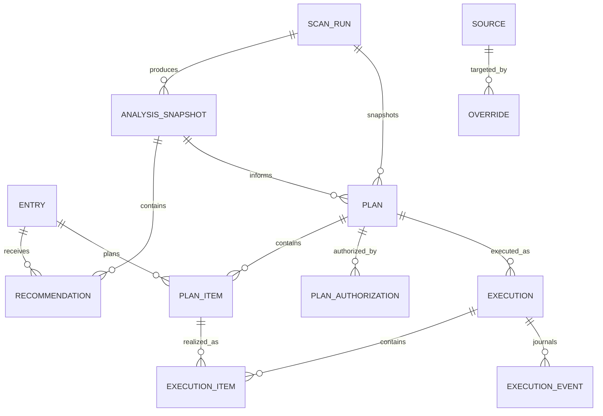

# M1 — Data Model (Schema v4)

Schema v3 adds M1 analysis, override, plan, authorization, execution, journal,
and verification structures. Schema v4 adds the raw selected destination path
(`destination_selected`) so redirection can be validated separately from the
canonical root. Both are forward migrations.

## 1. Entity relationships



## 2. Tables

### 2.1 `analysis_snapshots`

| Column | Notes |
| --- | --- |
| analysis_id | Deterministic from run + policy fingerprint + tool version |
| source_run_id | Inventory run |
| created_at | UTC |
| tool_version | Reproducibility |
| policy_fingerprint | Policy/types config hash |
| metrics_json | Recommendation/planning summary |

### 2.2 `recommendations`

| Column | Notes |
| --- | --- |
| analysis_id, entry_id | PK |
| disposition | Pre-override policy/duplicate recommendation |
| destination_rel | Reserved; null in M1 |
| rule_id, rationale, confidence | Explainability |
| duplicate_role | canonical / duplicate / unique |
| duplicate_group | Exact-duplicate group id |
| canonical_entry_id | Retained occurrence, if any |

### 2.3 `overrides`

| Column | Notes |
| --- | --- |
| override_id | Deterministic content hash |
| scope | `file` / `directory` |
| source_id, target_rel | Target |
| disposition | `copy` / `exclude` / `defer` / `duplicate_omit` |
| destination_rel | Optional explicit destination |
| reason | Required |
| active | 1/0; removal deactivates |
| created_at | UTC |
| superseded_by | Reserved |

### 2.4 `plans`

| Column | Notes |
| --- | --- |
| plan_id | `plan-<digest[:16]>` |
| plan_digest | SHA-256 of canonical plan body; unique |
| plan_schema_version | 1 |
| source_run_id, analysis_id | Provenance |
| destination_root, destination_selected, destination_template | Canonical root, raw operator-selected path, and template |
| duplicate_policy, target_platform, max_path_length | Policy settings |
| policy_fingerprint | Recommendation data hash |
| source_snapshot_json | Source identities + metadata fingerprints + roots |
| summary_json | Counts, bytes, conflicts, global issues |
| status | draft / authorized / paused / running / complete / complete_with_failures / verification_failed / verification_incomplete |
| created_at | UTC |

### 2.5 `plan_items`

| Column | Notes |
| --- | --- |
| plan_id, item_id | PK; item_id deterministic order |
| entry_id | Source occurrence |
| source_id, source_rel_path | Provenance |
| source_root_identity | Root used at planning |
| disposition | copy / duplicate_omit / exclude / defer / conflict |
| destination_rel | Required for copy |
| expected_sha256 | Planned content digest |
| size_bytes, source_mtime_ns | Revalidation |
| canonical_entry_id | Duplicate canonical occurrence |
| decision_source, reason | Explainability |

### 2.6 `plan_authorizations`

`authorization_id`, `plan_id`, `plan_digest`, `destination_root`,
`authorized_at`, `authorized_by`, `notes`.

Execution requires a matching plan id + digest.

### 2.7 `executions`

`execution_id`, `plan_id`, `plan_digest`, `destination_root`, `status`
(`running`, `paused`, `complete`, `complete_with_failures`,
`verification_failed`, `verification_incomplete`), `started_at`, `finished_at`,
`summary_json`.

### 2.8 `execution_items`

`execution_item_id`, `execution_id`, `item_id`, `state`
(`pending`, `verified`, `failed`, `conflict`), `destination_rel`,
`expected_sha256`, `actual_sha256`, `bytes_copied`, `attempts`, `error_code`,
`error_message`, timestamps.

Verification can transition `verified` to `failed` with error codes
`DESTINATION_MISSING`, `DESTINATION_UNREADABLE`, or `VERIFY_MISMATCH`; a later
verification can restore a matching destination to `verified`.

Unique `(execution_id, item_id)`.

### 2.9 `execution_events`

Append-only journal: `event_id`, `execution_id`, `item_id`, `sequence`,
`event_type`, `occurred_at`, `detail_json`.

Event types include `EXECUTION_STARTED`, `EXECUTION_RESUMED`,
`ITEM_STARTED`, `SOURCE_VERIFIED`, `DEST_PUBLISHED`, `ITEM_VERIFIED`,
`ITEM_FAILED`, `ITEM_CONFLICT`, `VERIFY_PASSED`, `VERIFY_FAILED`,
`VERIFICATION_COMPLETED`, `EXECUTION_PAUSED`, `EXECUTION_COMPLETE`,
`EXECUTION_COMPLETE_WITH_FAILURES`.

## 3. Plan digest body

```json
{
  "plan_schema_version": 1,
  "tool_version": "0.2.0",
  "source_run_id": "...",
  "analysis_id": "...",
  "destination_root": "...",
  "destination_selected": "...",
  "destination_template": "{source_id}/{rel_path}",
  "duplicate_policy": "prefer_one",
  "target_platform": "windows",
  "max_path_length": 240,
  "policy_fingerprint": "...",
  "source_snapshot": {},
  "items": [],
  "global_issues": []
}
```

Canonical serialization: sorted keys, compact separators, UTF-8, items sorted by
`item_id`.

## 4. Invariants

1. Every inventory file has at most one plan item per plan.
2. Every plan item references a real entry and source occurrence.
3. A `copy` item has a destination and expected SHA-256.
4. A non-copy item has a reason.
5. Plan items are immutable after creation.
6. Authorization is bound to the exact plan digest.
7. Execution items are unique per plan item.
8. Every plan item reaches an explicit reconciliation outcome.
9. No execution item reaches `verified` without a matching destination hash.
10. Verification failures transition items out of `verified` and persist an
    error code/event; they cannot retain stale success.
11. An existing destination is adopted only with execution provenance (prior
    `verified` state or a committed `DEST_PUBLISHED` event), never by hash alone.
12. Source files are never written by execution.
13. Destination publication never overwrites an existing path; unsupported
    atomic publication fails closed.
14. A changed plan digest invalidates prior authorization.
15. `balanced` reconciliation is accounting completeness; `successful`
    additionally requires every required copy to be verified and no blocking
    outcome.

## 5. Migration

- Schema v2 → v3 creates the tables above and records `m1_schema_migration`.
- Schema v3 → v4 adds `plans.destination_selected` and backfills existing plans
  from `destination_root`.
- Schema v1 → v2 → v3 → v4 remains supported.
- No destructive rewrite of inventory/hash data.
- Existing CP1 reports remain valid; M1 tables are additive.

## 6. Deliberate omissions

M1 does not add content evidence, classification, naming, plan editing,
fine-grained destination previews, or GUI-specific view state. Those belong to
later milestones and would otherwise freeze speculative contracts.
