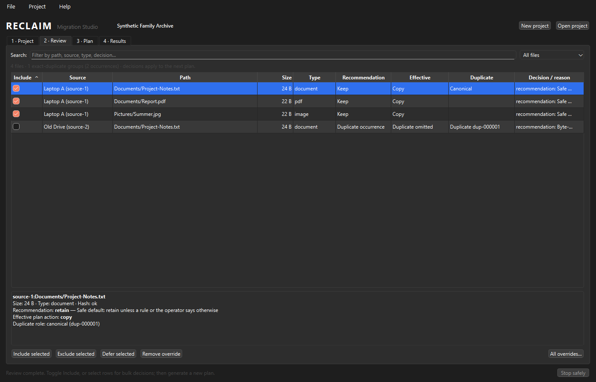
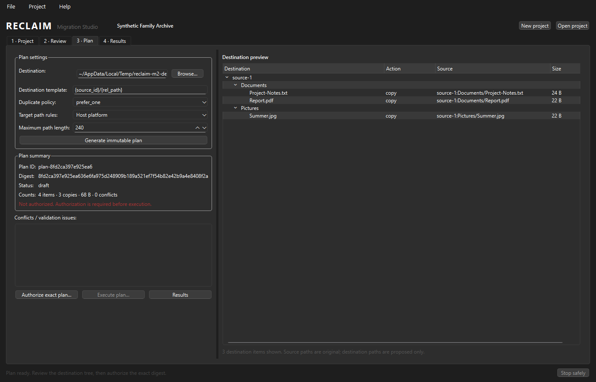
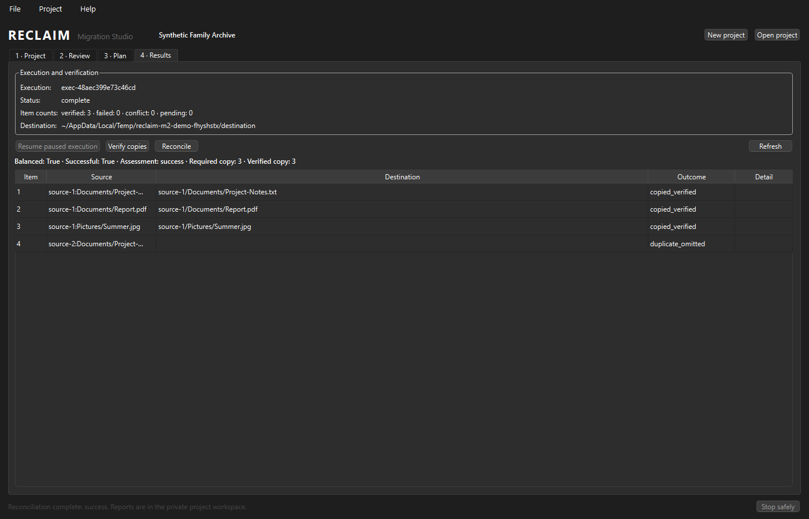

# M2 — Desktop Shell and Review Workflow

**Status:** Functional alpha implemented on `feat/m2`; operator review pending.
The GUI wraps the M1/M1A engine and never duplicates its planning, validation,
authorization, publication, or verification rules.



## What M2 adds

- PySide6 desktop shell with a four-step workflow: Project → Review → Plan →
  Results.
- Project creation/opening, source validation, destination validation, and
  free-space display.
- Background scan, hash, analysis, plan, execution, verification, and
  reconciliation jobs with progress and safe stop requests.
- Virtualized review table backed by `QAbstractTableModel`; search and filters.
- Individual checkbox decisions and bulk include/exclude/defer actions with
  required reasons and reversible file overrides.
- Immutable plan generation, digest display, destination-tree preview, conflict
  list, explicit digest authorization, execution, pause/resume, verification,
  and reconciliation.
- Project reopen with latest plan/execution state; paused executions can be
  resumed from Results.
- Qt offscreen GUI tests and synthetic end-to-end workflow tests.

## Run

```powershell
python -m pip install -e ".[gui]"
reclaim-gui
```

or, from a source checkout:

```powershell
$env:PYTHONPATH = "src"
python -m reclaim.gui.app
```

Pass a project config to open it at startup:

```powershell
python -m reclaim.gui.app path\to\reclaim-project.toml
```

Requires Python 3.11+ and PySide6 6.7–6.9. The engine remains usable without
PySide6 through the CLI.

## Documentation

- [Architecture and GUI boundaries](architecture.md)
- [Operator guide](user-guide.md)
- [Test and acceptance matrix](test-matrix.md)
- [Review-table benchmark](benchmarks.md)
- [Packaging and Qt/LGPL considerations](packaging.md)
- [M1 engine documentation](../m1/README.md)

## Screenshots

| Review | Plan |
| --- | --- |
|  |  |



Screenshots are generated from a synthetic temporary project with
`tools/capture_m2_screens.py`; they contain no real personal data.

## Scope boundary

M2 does not implement content extraction, document classification, naming
intelligence, semantic search, a SLM, or advanced destination-folder editing.
Those remain later milestones. M2 is a functional alpha, not the final visual
design or packaging/installer deliverable.
