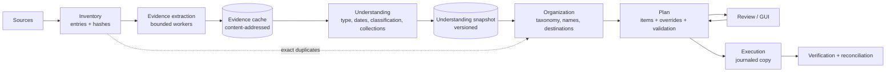

# Architecture Assessment — From CP1 Inventory to Reclaim Alpha

**Status:** Assessment for operator review.
**Basis:** CP1 implementation, tests, audit findings, and the product direction.
**Conclusion:** Preserve the CP1 foundation. Extend it with a document-evidence
pipeline, a persisted decision/plan layer, and a migration spine. Do not replace
the modular monolith.

---

## 1. What CP1 established

Implemented and tested:

- Read-only, multi-source enumeration with explicit link/cloud/exclusion and
  failure states.
- Source metadata-consistency fingerprints and overlap validation.
- Full SHA-256 hashing with size/mtime change detection and a resumable cache.
- Exact duplicate grouping and source-overlap analysis.
- Extension/signature type classification and data-driven policy rules.
- SQLite persistence (`schema_version` 2 after the CP1 corrective work).
- CSV/JSON reports, run manifests, and source-preservation evidence.
- CLI commands: `init`, `scan`, `hash`, `export`, `verify`, `status`.
- 46 synthetic tests, including cache-identity invalidation, schema migration,
  and default-run selection.

Strengths worth preserving:

- Clear read-only boundary and no source-write code path.
- Deterministic enumeration and exact hashing.
- Structured error codes and explicit failure states.
- Configuration-as-data and a generic default policy.
- A small, dependency-free core that is easy to test.

The CP1 audit also exposed the real-world constraints the architecture must
respect: composite second-generation sources, packaged media libraries, long
paths, unreliable timestamps, mixed naming, and large document collections that
must remain coherent.

---

## 2. Gap analysis

| Product capability | CP1 state | Needed for alpha |
| --- | --- | --- |
| Source/destination selection | TOML + CLI only | GUI picker, validation, capacity check |
| Inventory | Implemented | Persist source identity, stable occurrence key |
| Hashing / exact dedup | Implemented | Reuse; add content identity for evidence |
| Content extraction | None | Bounded extractors, normalized evidence, cache |
| Document type/subject | Extension/path heuristics | Evidence-based classifier with confidence |
| Date inference | Filesystem mtime only | Multi-source dates with provenance/confidence |
| Collection reconstruction | Exact-duplicate groups only | Cross-source relationship graph and clusters |
| Organization | Policy disposition only | Destination taxonomy/planner, preview |
| Filename recommendations | None | Quality assessment, policy, collision-safe names |
| Confidence | Rule confidence | Calibrated dimensions, presets, thresholds |
| Review | CSV/CLI summary | Persisted review workflow, GUI and bulk actions |
| Migration planning | None | Versioned plan, overrides, validation, preview |
| Execution | None | Journaled copy, resume, verification, reconciliation |
| GUI | None | PySide6 workflow consuming application services |
| Benchmarks | Synthetic tests | Labeled corpus, metrics, model comparisons |

The gap is large but mostly additive. The inventory/hashing layer is a sound
base; the missing work is evidence, decisions, planning, and execution.

---

## 3. Contracts that must change

### 3.1 Source identity and occurrence identity

**Fixed in CP1 follow-through:** source roots now have a `root_identity` derived
from canonical path plus volume identity; the hash cache is keyed by it and is
invalidated when a root changes.

Still needed:

- A stable **file occurrence key** across runs, e.g.
  `occurrence_uid = H(root_identity, rel_path, file_identity_hint)` or a
  persisted `(source_id, root_identity, rel_path)` unique key. Current
  `entry_id` is per run and cannot anchor evidence or overrides across rescans.
- A stable **content key** (`sha256`) for evidence and embedding caches. Content
  caches must never depend on a path.
- Explicit `source_epoch` or scan lineage so a re-registered source is not
  confused with its earlier self.

### 3.2 Evidence contract

The engine currently stores observations only. It needs a normalized,
versioned document-evidence contract separate from inference:

```python
@dataclass(frozen=True)
class DocumentEvidence:
    evidence_id: str
    content_sha256: str
    extractor_id: str
    extractor_version: str
    schema_version: int
    observed: ObservedMetadata       # filesystem, MIME, size, path context
    extracted: ExtractedFields       # title, author, dates, headings, text stats
    structure: StructureHints        # page/slide/sheet counts, sections, keywords
    provenance: list[EvidenceRef]    # page/paragraph/field/offset
    warnings: list[str]
    errors: list[ExtractionError]
```

Rules:

- Extraction output is **observed evidence**, not a classification.
- Every extracted field records where it came from and how confident the
  extractor is.
- Text is stored as a bounded, normalized representation; full raw text is not
  required for planning.
- Evidence is cached by `(content_sha256, extractor_id, extractor_version,
  config_hash)`.
- A failed extractor yields an explicit `ExtractionError`, never an empty
  success.

### 3.3 Inference and recommendation contracts

```python
@dataclass(frozen=True)
class DocumentUnderstanding:
    content_sha256: str
    document_type: str
    categories: list[CategoryAssignment]
    collection_candidates: list[CollectionRef]
    dates: list[DateEvidence]
    title_candidate: str | None
    confidence: ConfidenceVector

@dataclass(frozen=True)
class ConfidenceVector:
    extraction: float
    classification: float
    collection: float
    date: float
    filename: float
    calibrated: bool
```

`ConfidenceVector` fields are separate because a document can have excellent
text but an ambiguous category, or a strong category but a weak date.

### 3.4 Decision and plan contracts

- `recommendations` must persist rationale, evidence refs, rule/model versions,
  and confidence.
- `overrides` must be scoped (file/directory/pattern/project) and reversible.
- `plans` must be immutable after authorization, with a canonical hash.
- `plan_items` must reference a source occurrence and record effective
  disposition, destination, canonical duplicate, decision source, and reason.
- Execution must reference the exact plan hash and version.

CP1 computes recommendations at export time. That is suitable for an audit but
not for a GUI review workflow or a reproducible plan. These must be persisted.

### 3.5 Job/progress contract

The CLI currently prints progress. A GUI needs structured, cancellable jobs:

```python
class JobEvent:  # progress, warning, item_result, stage_started, stage_finished
    job_id: str
    stage: str
    completed: int
    total: int | None
    message: str
```

Long stages must be restartable and observable without parsing stdout.

---

## 4. Target module structure

```text
src/reclaim/
  domain/            # models, enums, invariants, plan/evidence contracts
  inventory/         # current scanner, hashing, store (retain)
  evidence/          # extractor registry, normalization, cache, workers
  understanding/     # dates, document type, classification, collections
  organize/          # taxonomy, naming, planner, destination validation
  execution/         # journal, copy, verify, reconcile
  semantic/          # embedding provider, model assets, optional SLM adapter
  benchmark/         # corpus loading, metrics, experiment runner
  adapters/
    cli/             # current CLI commands
    gui/             # PySide6 application (future)
    sqlite/          # repositories and migrations
    fs/              # filesystem-specific helpers
  util/
```

This is a target, not a demand to create empty directories now. The current
flat modules can be moved incrementally after the plan contract exists.

Dependency rule: `domain` depends on nothing; `inventory`, `evidence`,
`understanding`, `organize`, and `execution` depend on `domain`; adapters
depend on application services. The GUI never imports SQLite or filesystem
scanners directly.

---

## 5. Data flow



Evidence and understanding are snapshots. A plan may only be built from frozen
snapshots, so the same evidence/policy/model versions produce the same plan.

---

## 6. Technology assessment

### 6.1 Document extraction

| Format | Candidate | License | Assessment |
| --- | --- | --- | --- |
| PDF text/metadata | `pypdf` | BSD-3-Clause | Good baseline; pure Python; slower on large PDFs |
| PDF layout/fallback | `pdfminer.six` | MIT | Better text extraction; heavier; use as fallback |
| PDF (rich) | PyMuPDF | AGPL-3.0 / commercial | **Avoid** in a bundled product unless commercial license is purchased |
| DOCX | `python-docx` | MIT | Paragraphs, tables, core properties |
| PPTX | `python-pptx` | MIT | Slides, notes, core properties |
| XLSX | `openpyxl` | MIT | Sheet names, dimensions, cell text/metadata |
| Legacy DOC/XLS/PPT | `olefile` metadata; optional LibreOffice | BSD / MPL-2.0 | Metadata-only in v1; LibreOffice headless is large and should be optional |
| RTF | `striprtf` | MIT | Bounded text extraction |
| HTML | `beautifulsoup4` + `lxml` | MIT / BSD | Strip scripts/styles; no network |
| Plain text/Markdown | stdlib | PSF | Normalize encoding and size |
| OCR (scanned PDFs/images) | Tesseract | Apache-2.0 | Optional, gated, expensive; not alpha-critical |
| XML safety | `defusedxml` | PSF | Use for untrusted XML/Office XML paths |

Selection rules:

- Prefer permissive licenses compatible with redistribution.
- Keep extractors behind a registry; a missing optional extractor degrades to
  review, not failure.
- Do not extract archives by default; office files are ZIP containers but are
  parsed as documents, not unpacked into the destination.
- Verify licenses and transitive dependencies before packaging.

### 6.2 Extraction isolation

Document parsers are a security boundary. Run each extraction in a bounded
worker process:

- hard timeout per document (e.g., 30–60 s, configurable);
- maximum input size and decompressed size;
- maximum pages/slides/sheets and extracted text length;
- no network, no macro execution, no external entity resolution, no shell;
- no writing outside a temporary work directory;
- one crash or hang must not take down the analysis job;
- failures recorded with stable error codes and retry policy.

A worker pool of 2–4 processes is sufficient for a desktop dataset. Do not
build a container sandbox for the alpha; process isolation plus limits is
proportionate.

### 6.3 Embeddings

| Candidate | Params | Dim | License | Notes |
| --- | ---: | ---: | --- | --- |
| `BAAI/bge-small-en-v1.5` | 33M | 384 | MIT | Strong retrieval baseline; good size |
| `sentence-transformers/all-MiniLM-L6-v2` | 22M | 384 | Apache-2.0 | Small, fast, widely used |
| `intfloat/e5-small-v2` | 33M | 384 | MIT | Requires query/passage prefixes |
| `nomic-embed-text-v1.5` | 137M | 768 | Apache-2.0 | Stronger but larger; Matryoshka |

Recommendation: benchmark `bge-small-en-v1.5` and `all-MiniLM-L6-v2` first, on
ONNX Runtime CPU, quantized where quality holds. Do not commit to a model until
the benchmark in `testing-and-benchmarking.md` runs.

Runtime:

- **ONNX Runtime** (MIT) + `tokenizers` (Apache-2.0) + `numpy` (BSD).
- Avoid PyTorch for packaging size; use pre-exported ONNX models.
- Bundle the model asset with a version/hash manifest; allow an offline
  side-by-side asset for upgrades.
- Store vectors as compact binary blobs; batch inference; cache by content hash.
- For ≤200k documents, brute-force cosine similarity with NumPy is adequate.
  Do not add a vector database or HNSW index until measurements justify it.

Use embeddings for **candidate generation and similarity evidence**, not as a
direct probability. Classification and collection decisions must be explainable
from evidence plus thresholds.

### 6.4 Small language model (Enhanced, deferred)

| Candidate class | Examples | License caution |
| --- | --- | --- |
| ~0.6B | Qwen3-0.6B, SmolLM2-360M | Qwen/SmolLM2 Apache-2.0 (verify) |
| ~1.7B | SmolLM2-1.7B, Qwen3-1.7B | Apache-2.0 (verify) |
| ~1B | Llama 3.2 1B | Community license restrictions |

Runtime: `llama.cpp` (MIT) with a quantized GGUF model, CPU-first. Memory
roughly 0.5–1.5 GB depending on size/quantization. Use only for ambiguous
cases and bounded evidence summaries; require structured JSON output and
validate it. The SLM never controls file operations.

Do not bundle an SLM in the base alpha. Evaluate it only after the embedding
baseline and measured review burden exist.

### 6.5 GUI and packaging

- **PySide6 / Qt** remains the leading candidate. LGPLv3 requires dynamic
  linking, notices, and a plan for user replacement of Qt libraries; confirm
  with legal review before distribution.
- PyQt6 is GPL/commercial; not recommended unless the project adopts GPL.
- Tauri is a credible alternative if a web UI becomes a priority; it adds a
  Rust/web toolchain and does not remove the need for a tree-diff UI.
- Package with PyInstaller one-directory builds first; include model assets,
  licenses, and a version manifest. Nuitka is a later option if startup or
  performance requires it.
- Keep the core importable and testable without the GUI or model assets.

---

## 7. Determinism and reproducibility

To make plans reproducible:

1. Record extractor id/version and config hash with every evidence row.
2. Record model id, model file hash, runtime version, quantization, tokenizer,
   max length, and embedding dimension with every embedding.
3. Freeze evidence and understanding into an immutable analysis snapshot
   before planning.
4. Use deterministic tie-breaking for equal scores (e.g., content hash,
   occurrence key).
5. Build plan hashes from canonical serialization of frozen decisions, not from
   raw floating-point vectors.
6. Treat floating-point variation across CPUs as acceptable only if the
   discretized labels and plan hash remain stable; otherwise run inference on
   one designated worker configuration.

The plan must be explainable: each item records the evidence ids, rule/model
versions, and rationale that produced it.

---

## 8. Storage and performance

- Inventory: current SQLite schema, extended with evidence/analysis/plan tables.
- Evidence text: compressed, content-addressed store under the private
  workspace (`evidence/<sha256>.json.gz`), not in the source tree.
- Embeddings: SQLite blobs or a content-addressed binary store keyed by
  `(content_sha256, model_id)`.
- SQLite stays the transactional system of record; do not add a service or
  vector database.
- Expected scale: the initial dataset has ~15k non-media files and ~87 GB;
  a 100k-document benchmark should remain practical.
- Extraction is the expensive stage; cache aggressively and never re-extract
  unchanged content.
- GUI must page/virtualize lists; never load 100k rows into a widget.

---

## 9. Security and privacy

- Parsers are untrusted-input code: isolate, limit, and update.
- Never execute macros, scripts, or downloaded files.
- Do not follow links inside documents or archives.
- Do not extract archives during discovery; a deliberate archive-inspection
  feature is separate.
- Evidence caches contain document text; treat them as sensitive and keep them
  outside the repository.
- No telemetry, no automatic external calls, no model download without explicit
  consent.
- Log paths and error codes, not document contents.

---

## 10. Incremental migration path

1. **Keep** `scanner`, `hashing`, `store`, `paths`, `config`, and the CLI.
2. **Add** schema v3 for evidence/analysis/recommendation/override/plan tables.
3. **Extract** orchestration into application services while preserving the
   existing CLI behavior.
4. **Add** the evidence package and a CLI `evidence` command.
5. **Add** understanding and a CLI `analyze` command that persists
   recommendations.
6. **Add** planning/execution and a CLI `plan`/`execute`/`verify` workflow.
7. **Add** the GUI after plan/preview contracts are stable.
8. **Add** embeddings behind a provider interface; keep a no-model baseline.
9. **Add** SLM/external providers only after benchmark gates.

Do not rewrite the inventory layer. Its deterministic read-only behavior is the
project's strongest asset.

---

## 11. Principal risks

| Risk | Impact | Mitigation |
| --- | --- | --- |
| Extraction coverage/quality | Weak classifications, large review burden | Start with common formats; benchmark; explicit unsupported state |
| Parser security | Malicious document compromise | Worker isolation, limits, no macros/network, dependency updates |
| Confidence calibration | Users trust wrong automation | Separate dimensions, labeled calibration, conservative presets |
| Collection reconstruction | Wrong merges/splits | Evidence graph, confidence, review of uncertain groups |
| Filename regressions | Worse names, privacy leakage | Quality threshold, preserve original, review, no sensitive tokens |
| Model/package size | Installer bloat, slow startup | Small ONNX model, lazy load, optional asset |
| GUI scope | Delays alpha | Vertical slice after plan contracts; no advanced edit initially |
| Benchmark overfitting | Misleading quality claims | Synthetic + controlled real evaluation, held-out splits |
| Licensing | Distribution blocked | License review before bundling Qt/models/parsers |

---

## 12. Recommendation

Proceed with the CP1 architecture, extended by:

- a persisted evidence/understanding snapshot layer;
- a persisted recommendation/override/plan layer;
- a migration spine early, before the full intelligence layer;
- a GUI shell after plan contracts stabilize;
- embedded embeddings behind a provider interface, benchmarked against a
  no-embedding baseline;
- no SLM or external provider in the alpha.

The next work package should be the **migration spine + plan contract**, not a
document-understanding research spike. It creates the destination, review, and
verification substrate that every intelligence improvement must ultimately
feed.
