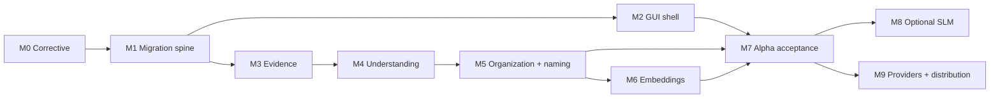

# Reclaim Engineering Roadmap

**Status:** Proposed for operator authorization.
**Goal:** A usable, GUI-driven alpha that safely completes the real 87 GB
migration, followed by benchmark-gated semantic intelligence.
**Planning assumption:** one to two engineers plus the operator for review and
acceptance. Estimates are ranges, not commitments.

---

## 1. Sequencing strategy

The roadmap is organized around **vertical, testable slices**, not a
layer-by-layer research program.

Three rules drive the order:

1. **A migration path must exist early.** A perfect classifier with no safe
   executor cannot deliver the product. The plan/copy/verify spine comes first.
2. **The GUI must be able to exercise the spine before intelligence is
   complete.** An early shell with a simple organizer validates the workflow,
   review model, and destination preview while evidence work proceeds.
3. **Intelligence is added behind frozen contracts and benchmark gates.**
   Extraction, classification, collections, naming, and embeddings each improve
   the same plan model; none may destabilize execution.

This deliberately departs from a linear "extract → classify → organize → build
GUI → execute" sequence. It also avoids spending months on model research before
the operator can run a safe migration.

---

## 2. Milestone overview

| ID | Milestone | Primary outcome | Depends on | Indicative effort |
| --- | --- | --- | --- | ---: |
| **M0** | CP1 corrective foundation | Cache identity fixed; AGENTS tracked; archive registered; terminology corrected | CP1 | 1 week (this assignment) |
| **M1** | Migration spine + plan contract | CLI can build, validate, preview, execute, and verify a safe plan | M0 | 3–4 weeks |
| **M2** | Desktop shell + review | PySide6 alpha shell can run the M1 workflow without a terminal | M1 | 4–6 weeks |
| **M3** | Evidence extraction v1 | Bounded extraction of common document formats into versioned evidence | M1 | 4–6 weeks |
| **M4** | Understanding v1 | Dates, document types, categories, collection candidates, confidence | M3 | 4–6 weeks |
| **M5** | Organization + naming v1 | Human-useful destination planner and filename recommendations | M4, M1 | 3–5 weeks |
| **M6** | Embedded semantics | Benchmarked local embedding model integrated behind a provider | M4, M5 | 4–6 weeks |
| **M7** | Real-world alpha acceptance | Full GUI migration of the 87 GB dataset, reconciled and verified | M2, M5, M6 | 2–3 weeks |
| **M8** | Optional Enhanced SLM | Benchmark-gated local SLM for ambiguous cases | M7 | 4–6 weeks |
| **M9** | External providers + distribution | Opt-in provider interface, signed builds, release readiness | M7 | 3–5 weeks |

M2 and M3 can run in parallel after M1. M4 starts when M3's schema stabilizes.
M6 starts only after M5 produces a stable plan shape.

---

## 3. M0 — CP1 corrective foundation

**Status:** Implemented in this assignment; awaiting review.

Scope:

- Source-root identity and hash-cache invalidation (schema v2).
- `AGENTS.md` made trackable; no private paths.
- Metadata-consistency terminology separated from byte integrity.
- Completed iPhoto archive verified and registered through a supplemental run.
- Operator-resolved source questions recorded; no further recovery workstream.
- Regression tests and CP1 baseline preservation.

**Gate:** Tests pass; archive digest/size/registration recorded; CP1 baseline
run remains intact; operator accepts the corrective diff.

**Risk:** Rehashing after cache invalidation takes time but is safe; it does not
alter source content.

---

## 4. M1 — Migration spine and plan contract

> **Status 2026-11-22:** Implemented and hardened by M1A on `feat/m1`;
> 113 synthetic tests pass. Operator review pending. See
> [`docs/m1/`](../m1/README.md).

**Objective:** Prove that Reclaim can plan and execute a safe migration before
adding intelligence.

### Scope

1. **Schema v3/v4**
   - `analyses`, `recommendations`, `overrides`
   - `plans`, `plan_items`, `plan_edits`
   - `executions`, `execution_items`, `execution_events`,
     `destination_verifications`
   - `plan_schema_version` and migration tests.
2. **Plan builder v0**
   - Preserve source-relative structure by default.
   - Optional simple top-level collection mapping from a TOML template.
   - Exact-duplicate policy: one canonical occurrence, all provenance retained.
   - Effective disposition resolution with the documented precedence chain.
3. **Destination validator**
   - Path traversal, reserved names, invalid characters, trailing spaces/dots,
     case-fold collisions, Unicode normalization, length budget, source overlap,
     duplicate destinations, existing-file conflicts.
4. **Preview**
   - CLI tree summary and counts by source/destination/disposition.
   - Plan hash and a machine-readable plan export.
5. **Executor**
   - Copy to a temp file in the destination directory, flush, hash, atomic
     rename.
   - Never overwrite; collision policy is explicit.
   - Journal every state transition; resume after interruption.
   - Explicit authorization pinned to plan hash/version.
6. **Verification/reconciliation**
   - Post-copy hash verification.
   - `reconciliation.csv` accounting for every source occurrence.
7. **Tests**
   - Synthetic end-to-end, interrupted copy, full disk, permission denial,
     destination collision, source change mid-run, resume, no-overwrite.

### Deliverables

- CLI: `plan`, `preview`, `authorize`, `execute`, `verify`, `reconcile`.
- Schema v3/v4 migration.
- Synthetic end-to-end and fault-injection tests.
- A short operator guide for a dry run.

### Acceptance gate

- Synthetic migration completes with 100% reconciliation and zero source
  changes.
- Interrupting at multiple points and resuming produces a complete result.
- Destination validation rejects every hostile path in the test matrix.
- A live dry run on the real dataset produces a plan without writing files.
- Operator approves the plan schema and duplicate/destination policy.

### Risks

- Destination semantics differ across filesystems; test Windows first, then
  macOS/Linux.
- Plan schema churn; keep it minimal and versioned.
- Resume edge cases; journal-first design and fault injection are essential.

---

## 5. M2 — Desktop shell and review workflow

**Objective:** Make the M1 workflow usable without a terminal.

### Scope

- PySide6 application shell with:
  - source and destination selection, validation, free-space display;
  - scan/hash/analyze jobs with progress and cancel;
  - review table with filters and bulk accept/reject;
  - destination preview tree with counts and conflict badges;
  - execution authorization, progress, and verification report.
- Application services and job events; no SQL or filesystem traversal in the UI.
- Simple organization policy for the first shell; richer recommendations arrive
  from M4/M5 without changing the UI contracts.
- Crash/resume behavior; project reopen.

### Acceptance gate

- A non-technical tester completes a synthetic migration through the GUI.
- Closing the app mid-execution and reopening allows safe resume.
- The GUI never bypasses plan validation or authorization.
- Review actions change the effective plan immediately and are reversible.

### Risks

- Qt packaging/licensing.
- Scope creep into advanced editing; defer folder-create/rename/nest tools to a
  later milestone.
- Large-table performance; virtualize from the start.

---

## 6. M3 — Evidence extraction v1

**Objective:** Turn supported documents into bounded, provenance-rich evidence.

### Scope

- Extractor registry with explicit versions and capability declarations.
- Formats: PDF, DOCX, PPTX, XLSX, TXT/Markdown, RTF, HTML; legacy Office
  metadata only in v1.
- Normalized evidence contract: title, author/organization, embedded dates,
  headings, document type hints, page/slide/sheet counts, text statistics,
  bounded keyword/phrase extraction.
- Content-addressed evidence cache with extractor/config versioning.
- Worker-process isolation, timeouts, size/text caps, no macros/network/entity
  expansion.
- CLI `evidence`/stats; failure codes; coverage report.

### Acceptance gate

- Extraction coverage and failure rates are measured on the benchmark corpus.
- No parser crash can terminate the analysis job.
- Cached evidence is reused for unchanged content.
- Sources remain metadata-consistent; no source writes.
- A failure never produces a silent empty evidence record.

### Risks

- Scanned PDFs and legacy formats may need OCR/LibreOffice; keep them optional
  and explicitly report unsupported cases.
- Parser security and licensing.
- Extraction time on large decks/PDFs.

---

## 7. M4 — Understanding v1

**Objective:** Infer document type, dates, categories, and collection
relationships with explicit provenance and confidence.

### Scope

- Date evidence: filesystem, embedded metadata, content text, filename,
  collection context; each with provenance and confidence. Never collapse to a
  single authoritative date.
- Document-type classifier using evidence features and rules; hierarchical
  category taxonomy (shallow, configurable).
- Collection reconstruction across sources:
  - candidate edges from similarity, shared terminology, dates, filenames, and
    source context;
  - deterministic clustering with confidence;
  - review of uncertain merges/splits.
- Confidence vector and initial calibration; explanation payload per decision.
- Persisted analysis snapshot and CLI review commands.

### Acceptance gate

- Baseline classification and collection metrics measured on the labeled
  corpus, including a no-evidence baseline.
- Every recommendation has evidence refs and rationale.
- Ambiguous items are routed to review rather than forced into a category.
- Plan generation is deterministic from a frozen analysis snapshot.

### Risks

- Collection reconstruction is the hardest quality problem; do not promise
  perfect grouping.
- Taxonomy may need operator input; keep it configurable.
- Calibration data is limited; label the corpus carefully.

---

## 8. M5 — Organization and filename recommendations v1

**Objective:** Convert understanding into a human-useful destination tree and
safe filename proposals.

### Scope

- Destination taxonomy/templates with shallow hierarchy and collection-aware
  grouping.
- Filename quality assessment and three policies:
  - Preserve;
  - Intelligent (default; rename only when materially better);
  - Standardized (opt-in; configurable template).
- Name evidence: title/subject, dates, document type, collection context.
- Portability and collision validation; original filename retained in plan.
- Preview diff showing original → proposed name and destination.
- Dependency-sensitive files/packages never renamed internally.
- Review and bulk override.

### Acceptance gate

- Naming proposals meet an acceptance threshold on a human-labeled sample.
- No invented dates/versions/titles; every change cites evidence.
- Zero invalid destinations, zero collisions, zero overwrites.
- Plan determinism and revert behavior verified.

### Risks

- Filename improvements can be subjective; measure, don't assume.
- Sensitive content must not leak into names.
- Overly precise names create false authority; prefer conservative templates.

---

## 9. M6 — Embedded semantic intelligence

**Objective:** Improve classification, collection, and naming with a local
embedding model, measured against the deterministic baseline.

### Scope

- ONNX Runtime embedding provider; model asset manifest/hash; offline operation.
- Embedding cache keyed by content hash/model/runtime.
- Candidate generation for document type, related documents, and collection
  edges; hybrid with M4 features.
- A/B benchmark against M4 baseline across thresholds.
- Model selection decision: adopt, keep optional, or defer.
- Packaging footprint/latency/memory measured.

### Acceptance gate

- A measurable improvement in classification/collection metrics or review
  burden, with no regression in safety or determinism.
- Model license and redistribution approved.
- Packaged size and startup impact within agreed budget.
- If no material improvement, keep embeddings as an optional experiment and
  ship the deterministic engine.

### Risks

- Embedding similarity can look impressive but add little over good evidence
  features.
- Model/runtime packaging and CPU performance.
- Reproducibility across machines.

---

## 10. M7 — Real-world alpha acceptance

**Objective:** Complete the real migration through the GUI and verify it.

### Scope

- Full inventory, evidence, analysis, plan, review, execute, verify on the
  staged 87 GB dataset.
- Interruption/resume, destination collision handling, long paths, media
  deferral.
- Operator acceptance walkthrough; issue triage; performance tuning.
- Signed-off reconciliation and archive handling.

### Acceptance gate

- 100% of source occurrences reconciled.
- Every copied file verified against its planned digest.
- Sources unchanged (metadata consistency plus targeted hash checks).
- Destination is navigable and materially better organized.
- Operator signs off on the alpha.

### Risks

- Real data exposes format/path/performance edge cases.
- Review burden may exceed target; use the review metrics to tune thresholds.
- Media remains deferred; alpha is document-focused.

---

## 11. M8 — Optional Enhanced SLM

**Objective:** Determine whether a bundled small language model materially
improves ambiguous interpretation.

### Scope

- Evaluate 0.6B and 1.7B Apache-2.0 candidates (e.g., Qwen3-0.6B, SmolLM2).
- Use only for ambiguous classification/collection/name candidates with bounded
  evidence summaries.
- Structured JSON output, schema validation, no file operations.
- Compare against M6 baseline on accuracy, review burden, latency, memory,
  installer size.
- If justified, define an Enhanced edition and packaging.

**Gate:** A pre-registered improvement threshold is met; licensing and support
costs are acceptable. Otherwise do not ship an SLM.

---

## 12. M9 — External providers and distribution

**Objective:** Prepare optional external reasoning and a distributable alpha.

### Scope

- Provider interface (DeepSeek/OpenAI-compatible/local server) with explicit
  project-level authorization, redaction preview, and no automatic fallback.
- Signed/notarized per-OS builds; dependency/license inventory.
- CI matrix (Windows, macOS, Linux), model asset verification, release
  documentation.
- Privacy/security review.

**Gate:** Alpha is stable offline; external providers are opt-in and disabled by
default; license and distribution review complete.

---

## 13. Dependency graph and critical path

Critical path: **M0 → M1 → M3 → M4 → M5 → M6 → M7**. M2 runs in parallel with
M3/M4 and must be ready before M7.

---

## 14. Proposed alpha definition

The alpha is complete when:

1. A non-technical user can select multiple sources and a destination in the
   GUI.
2. Reclaim inventories, extracts, classifies, and proposes an organization
   without modifying sources.
3. The user can review uncertain exclusions, categories, collections, and name
   changes, and preview the destination tree.
4. The user explicitly authorizes execution.
5. Reclaim copies with collision safety, resumes after interruption, verifies
   every destination file, and produces a complete reconciliation.
6. The document-focused migration of the real dataset succeeds; media remains
   deferred.
7. The operator accepts the destination as useful and explainable.

M6 is on the alpha critical path. If it fails its improvement gate, the operator
decides whether to ship a deterministic-only alpha (with embeddings continuing as
an opt-in experiment) or defer alpha acceptance. The deterministic engine must
always remain a complete fallback.

---

## 15. Decisions required before each gate

| Gate | Decisions |
| --- | --- |
| M1 start | Approve plan schema, duplicate policy, destination validation rules, dry-run scope |
| M1 close | Approve a live dry-run plan; confirm canonical-copy policy |
| M2 start | Approve PySide6/LGPL and GUI scope; confirm review workflow |
| M3 close | Approve supported-format list and extraction privacy policy |
| M4 close | Approve taxonomy and collection confidence behavior |
| M5 close | Approve naming policies and destination templates |
| M6 start | Approve model candidates, license review, packaging budget |
| M6 close | Adopt/keep-optional/defer embedding model |
| M7 | Authorize the real migration and accept the result |
| M8 | Approve Enhanced edition only if benchmark justifies it |
| M9 | Approve external-provider privacy model and release plan |

---

## 16. What this roadmap deliberately does not do

- It does not build a plugin system.
- It does not add a vector database, service, or daemon.
- It does not implement OCR, legacy Office conversion, or archive extraction
  before the common-format path works.
- It does not implement an SLM because the architecture allows one.
- It does not make external AI a dependency.
- It does not promise universal format support or perfect classification.

---

## 17. Schedule risks

| Risk | Consequence | Mitigation |
| --- | --- | --- |
| Evidence extraction takes longer than expected | Intelligence milestones slip | Time-box v1 formats; measure coverage; ship unsupported-state review |
| Collection reconstruction quality is weak | Review burden stays high | Benchmark early; allow manual collection grouping; don't over-automate |
| GUI scope expands | Alpha delayed | M2 is a shell, not advanced edit; defer folder surgery |
| Confidence calibration lacks labels | Thresholds are arbitrary | Build labeled corpus before M4 closes |
| Model packaging bloats installer | Adoption friction | Small ONNX model; optional asset; measure |
| Destination edge cases | Data safety incident | Validator test matrix; dry runs; journaling; no overwrite |
| Operator review bandwidth | Gate delays | Batch review, clear summaries, pre-registered acceptance criteria |
